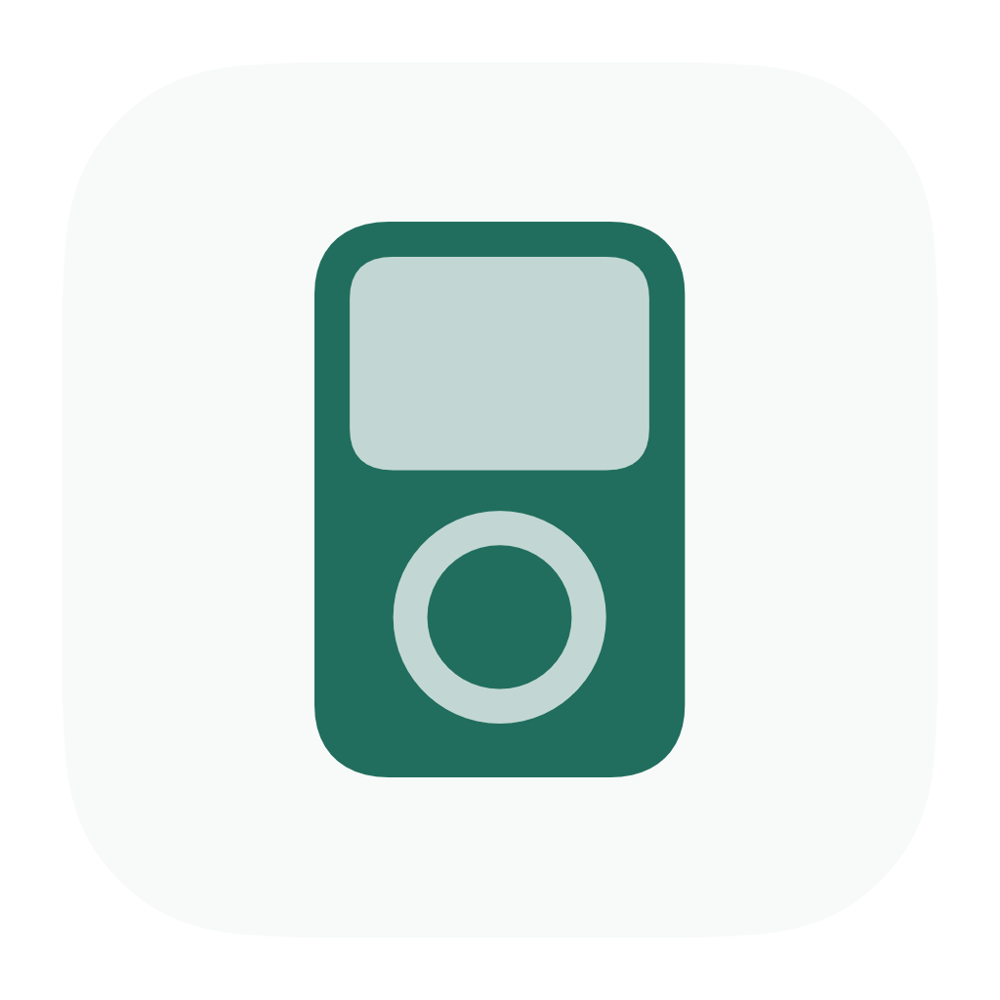

<p align="center">
  
</p>

<h1 align="center">NanoBridge</h1>

<h3 align="center">把音乐，带回 iPod · Music for your pocket</h3>

<p align="center">网易云下载 · NCM 解码 · AAC 转换 · iPod 音乐准备</p>

<p align="center">
  <a href="https://github.com/zhengchangr/NanoBridge/releases/latest"><strong>⬇️ 下载最新版 · Download latest release</strong></a>
</p>

NanoBridge 是一个为 iPod nano 准备本地音乐的工具。你可以添加网易云歌曲或歌单链接，也可以拖入 NCM、FLAC、MP3 等音频文件，将音乐转换为保留标签和封面的 AAC / M4A，再导入 iPod。macOS 版使用原生 SwiftUI，Windows 版提供免安装包。

> 本项目是独立开发的第三方工具，与网易云音乐及 Apple 无隶属关系。在线下载以账号权限为准；设备传输由 Finder 或 TunesReloaded 完成。

English: NanoBridge prepares music for iPod nano on macOS and Windows. Add NetEase Cloud Music links or local audio files, decode NCM, and convert tracks to AAC / M4A while preserving metadata and artwork. Transfer the prepared music using Finder on macOS or TunesReloaded on Windows.

## 下载

| 平台 | 系统要求 | 使用方式 |
| --- | --- | --- |
| [macOS 版](https://github.com/zhengchangr/NanoBridge/releases/latest) | macOS 15+ · Apple Silicon | 下载 `macOS-arm64.zip` 结尾的包，解压后打开 `NanoBridge.app` |
| [Windows 版](https://github.com/zhengchangr/NanoBridge/releases/latest) | Windows 10/11 · x64 | 下载 `Windows-x64.zip` 结尾的包，解压整个文件夹后运行 `NanoBridge.exe` |

Windows 的详细用法和构建方法见 [Windows 使用说明](windows/README.md)。

两个版本均内置所需运行组件，无需用户另行安装 Node、Python 或转码工具。macOS 包使用本地临时签名，尚未经过 Apple 公证；Windows 包尚未使用发行证书签名。

## 功能

- **添加音乐**：网易云歌曲 / 歌单链接、本地音频文件或整个文件夹，支持拖入。
- **转换音乐**：NCM 解码，输出 AAC-LC / M4A，支持 128 / 192 / 256 kbps，保留标题、歌手、专辑和封面。
- **管理队列**：查看处理进度，停止任务、移出歌曲或重试失败项，保留源文件。
- **准备 iPod 音乐**：macOS 可自动导入“音乐”App 的 NanoBridge 播放列表；Windows 提供 TunesReloaded 导入入口。
- **软件更新**：检查 GitHub 最新 Release，验证更新签名，下载安装并在任务和队列允许时重新启动。

## macOS 构建

本机已构建的应用：`build/NanoBridge.app`，双击运行。

重新构建需要 Xcode 或 Command Line Tools：

```sh
zsh build.sh
open build/NanoBridge.app
```

支持 macOS 15 及以上；生成与构建机器架构一致的应用，本机为 Apple Silicon。应用使用本机临时签名，尚未公证。

## macOS 使用

1. 本地音乐：在“添加音乐”中选择“本地文件”，点击“选择文件 / 文件夹”，或把文件拖入窗口。支持 NCM、MP3、FLAC、M4A、AAC、WAV、AIFF。添加文件夹时递归读取支持的音频，跳过隐藏文件和软件包。
2. 在线音乐：切换至“网易云链接”，点击“网易云登录”，在手机网易云 App 中扫码。将完整的歌曲或歌单链接粘贴进输入框，每行一条，点击“加入队列”。支持 `music.163.com`、`y.music.163.com` 的常见链接；短链接请先在浏览器打开，再复制完整地址。
3. 在队列中确认歌曲，点击“开始转换并导入”。默认输出 AAC-LC / M4A、256 kbps、44.1 kHz、立体声，点击“输出设置”可改为 128 或 192 kbps，并更改输出文件夹。保留标题、歌手、专辑和封面。输出默认位于 `~/Music/NanoBridge`。
4. 首次导入时，macOS 可能询问是否允许控制“音乐”，请允许。在“输出设置”关闭“自动导入”可只生成音频文件。
5. 用数据线连接 iPod nano，在 Finder 选择设备 → 音乐 → 同步所选播放列表 → 勾选 `NanoBridge` → 应用/同步。等待 Finder 完成后弹出设备。

如果设备与其他资料库关联，Finder 可能提示“抹掉并同步”，请先确认备份。应用不会确认此提示，也不直接改写 iPod 数据库。

## 行为和限制

- 下载使用网易云返回的完整下载地址；没有下载权限、空地址或标记为试听时明确失败，不自动改用试听链接。会员、地区和单曲购买权限由账号决定。在线下载请求最高使用 `exhigh`，随后转换为所选 AAC 码率。
- 网易云接口不是本项目控制的稳定服务，上游变动可能导致在线功能失效。登录凭证仅存入 macOS 钥匙串，音频 CDN 请求不携带登录凭证，没有外部 API 中转服务。
- NCM 只支持内部音频为 MP3 / FLAC 的常见格式，不支持其他平台加密文件或所有可能的网易云格式变种。
- AAC 是有损格式；将有损音源重新转换不会提高音质。
- 保留源文件。任务临时文件在结束时清理。内容指纹和码率用于复用同名输出，避免重复转码；“音乐”导入按路径检查是否已经在目标播放列表中。
- 清空/移出队列不删除任何源文件或输出文件。队列不跨应用重启保存；登录状态和输出设置会保存。
- 停止会取消网络请求，在当前系统转码/资料库导入结束后退出，不强制中断正在写入的文件。
- 现代“音乐”App 的脚本字典没有 iPod 同步命令，因此本版将同步交给 Finder；未连接设备时不会声称已传输至 iPod。

## 验证

```sh
zsh check.sh          # 使用合成音频，无需账号
zsh check.sh --live   # 访问网易云实际接口，不读取钥匙串凭证
```

本地检查使用独立 Python/OpenSSL 编码器生成 NCM 测试文件，再验证解码音频逐字节一致、损坏输入拒绝、链接解析、试听/无权限下载拒绝、AAC 编码参数和时长，以及中文标签和封面保留；另外检查导入 AppleScript 的编译。

真实接口已验证二维码生成/轮询、歌曲详情和下载接口返回。测试歌曲需要账号下载权限，因此**登录后完整下载、真实“音乐”资料库导入、iPod nano 硬件同步尚未完成端到端验证**。

## macOS 软件更新

点击窗口右上角“检查更新”，或使用 NanoBridge 菜单中的“检查更新…”。可以立即检查，也可以开启自动检查与自动下载安装。更新来自 GitHub 最新正式 Release 附带的 `appcast.xml`；下载和更新清单都经过 Ed25519 签名验证，通过后由内置的 Sparkle 安装并重新启动。首次 Release 发布前，线上更新源暂不可用。

默认每天自动检查，自动下载可在更新面板开启。自动下载的更新在退出时安装。手动安装若遇到正在处理的任务或尚未清空的队列，会等处理结束且队列清空后再重启，避免丢失内存中的队列；清空队列不删除音乐文件。

构建时自动下载固定版本的 Sparkle 并验证 SHA-256，最终用户不需要另行安装。制作支持自动更新的 macOS 发行包：

```sh
zsh scripts/package-macos.sh
zsh Tests/check-updates.sh
```

发布前递增 `Info.plist` 中的 `CFBundleVersion`（用于比较新旧）和 `CFBundleShortVersionString`（显示版本号）。将 `build/releases/macos-版本号/` 中的 ZIP、`appcast.xml`、`SHA256SUMS.txt` 一并上传到对应的 `v版本号` GitHub 正式 Release。不要修改已签名的更新清单；修改后须重新运行打包脚本签名。Windows 同样提供检查、自动下载和退出时安装；Windows 发行包、签名更新清单及打包说明见 [Windows 文档](windows/README.md)。

发行签名私钥保存在本机登录钥匙串的 Sparkle 签名条目中，account 为 `local.caoyun.nanobridge.sparkle`；仓库只保存公钥。换构建机器前请通过 Sparkle 的 `generate_keys` 工具安全备份和迁移原私钥，不要重新生成或提交私钥，否则已安装版本将无法验证更新。

## 参考

- [网易云接口协议及端点参考](https://github.com/NeteaseCloudMusicApiEnhanced/api-enhanced)
- [NCM 格式参考](https://github.com/taurusxin/ncmdump)
- [Apple：与电脑同步 iPod](https://support.apple.com/en-ie/108311)

音频代码使用系统 CommonCrypto、CryptoKit、AVFoundation 和 `afconvert` 实现，不捆绑上述参考项目。macOS 自动更新使用 [Sparkle 2.10.1](https://github.com/sparkle-project/Sparkle/releases/tag/2.10.1)，许可证随应用保存在 `Contents/Resources/Sparkle-LICENSE.txt`。
